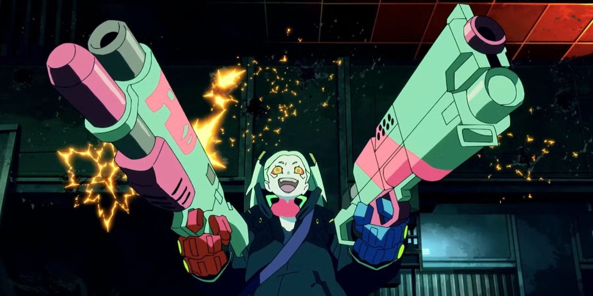
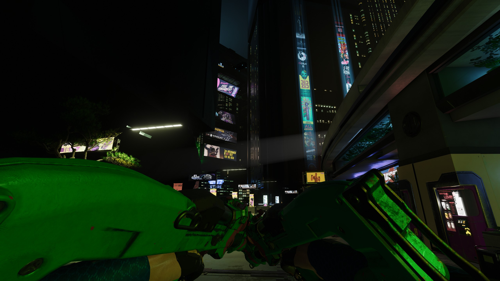
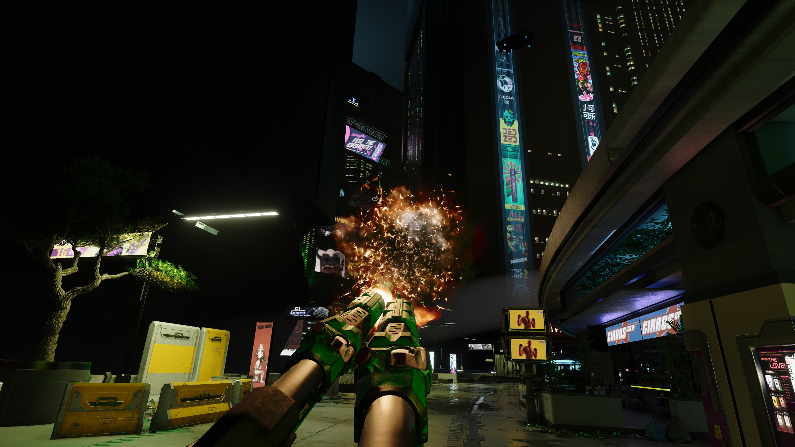

# Gorilla Grip

Gorilla Arms let V dual-wield SMGs and shotguns.

Patch 2.5 added dual-wielding through the **Double Trouble** perk (Cool), limited to pistols and revolvers. Gorilla Grip extends it: while **Gorilla Arms** are equipped, their reinforced grip actuators steady heavier guns one-handed, so SMGs and shotguns can be paired too. Without Gorilla Arms, everything stays vanilla.

## Screenshots

The inspiration, from *Cyberpunk: Edgerunners*:


<sub>Still from *Cyberpunk: Edgerunners* (Studio Trigger / CD PROJEKT RED). Not covered by this mod's license.</sub>

V with Gorilla Arms, dual-wielding two Guts in Corpo Plaza:





## Features

- With Gorilla Arms equipped and Double Trouble unlocked, SMGs and shotguns (including double-barrel shotguns and modded weapons of those types) can be dual-wielded.
- Without Gorilla Arms, only pistols and revolvers can be dual-wielded, as in vanilla. Removing Gorilla Arms unequips the off-hand SMG or shotgun.
- Fits the game's UI:
  - Double Trouble's weapon box reads *"Only affects Power Pistols and Power Revolvers; equipping Gorilla Arms extends this to SMGs and Shotguns"*.
  - Gorilla Arms get a tooltip line: *"Reinforced grip actuators steady SMGs and shotguns one-handed: with Double Trouble, they can be dual-wielded."*
- No new perk, no save data, no animation replacement. It reuses the game's own dual-wield system.

## Requirements

- Cyberpunk 2077 **2.5**
- [RED4ext](https://www.nexusmods.com/cyberpunk2077/mods/2380)
- [redscript](https://www.nexusmods.com/cyberpunk2077/mods/1511)
- [TweakXL](https://www.nexusmods.com/cyberpunk2077/mods/4197)
- [Codeware](https://www.nexusmods.com/cyberpunk2077/mods/7780)

## Installation

Extract the archive into the Cyberpunk 2077 game folder, or install it with Mod Organizer 2 or Vortex. The files go to:

```
r6/scripts/GorillaGrip/GorillaGrip.reds
r6/tweaks/GorillaGrip/GorillaGrip.yaml
```

## Uninstallation

Unpair any dual-wielded SMGs or shotguns first, then remove the two files. Nothing is written to your save.

## Known limitations

- SMGs and shotguns use the game's pistol dual-wield animations, so some reloads and hand poses look unusual.
- Double Trouble's own bonuses (recoil, spread, Heywood Hurricane) follow the game's rules; this mod only changes which weapons can be paired.
- Other mods that change which weapons can be dual-wielded (for example Expanded Dual Wielding or Dual Wield Anything) do the same job in a different way. Use one of them.

## How it works

- At load, a Codeware `ScriptableTweak` goes through all weapon and item records: it adds the game's `DualWield` tag to every SMG and shotgun and adds the tooltip line to Gorilla Arms. The counts are written to the redscript log.
- A wrap of `gameItemData.CanDualWield` keeps those weapon types dual-wieldable only while an item of type `Cyb_StrongArms` is equipped in the arms cyberware slot.
- A wrap of the perk tooltip adds the Gorilla Arms clause to Double Trouble's weapon box.
- Texts are registered through Codeware's localization system (English).

## License

MIT, see [LICENSE](LICENSE).
